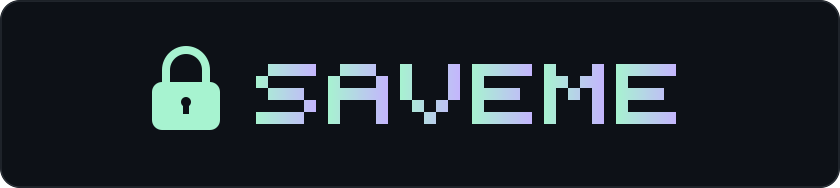
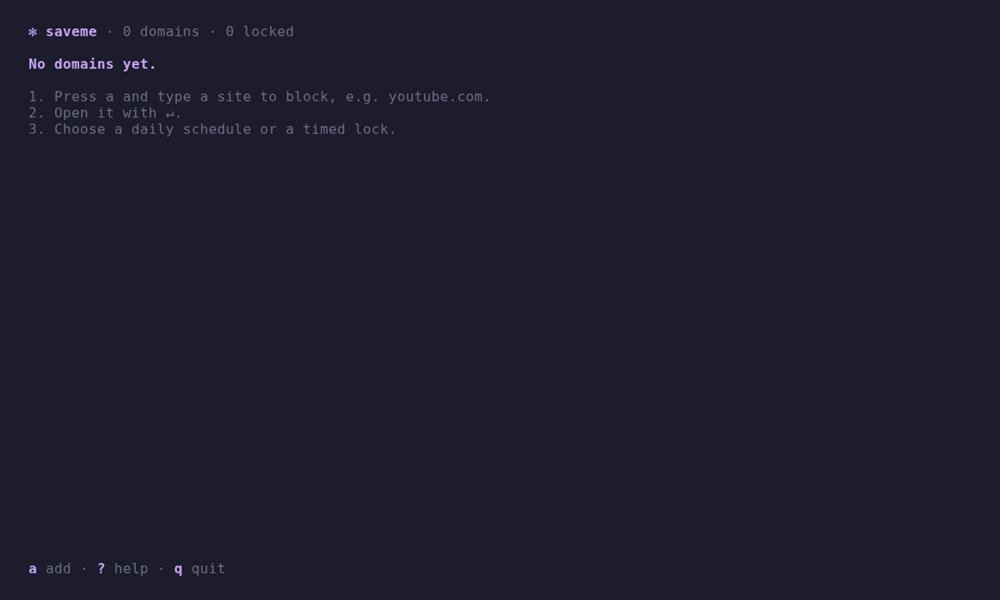

<p align="center">
  
</p>

<p align="center">
  Block distracting sites from your terminal — per domain, on a schedule or a timer.
</p>

<p align="center">
  <a href="docs/install.md">Install</a> ·
  <a href="docs/setup.md#use">Usage</a> ·
  <a href="docs/setup.md#terminal-appearance">Settings</a> ·
  <a href="docs/install.md#uninstall">Uninstall</a> ·
  <a href="docs/setup.md#limits">Limits</a> ·
  <a href="https://github.com/Catherine1401/saveme/releases">Releases</a>
</p>

<p align="center">
  <a href="docs/assets/demo.mp4"></a>
</p>

## Install

**Linux**

```sh
curl -fsSL https://raw.githubusercontent.com/Catherine1401/saveme/main/install.sh | bash
```

**Windows** ([experimental](docs/install.md#windows))

```powershell
& ([scriptblock]::Create((irm https://raw.githubusercontent.com/Catherine1401/saveme/main/install.ps1)))
```

## Features

- Daily or 1h–30d locks, per domain
- Lock several domains at once
- 16 themes, 10 clock styles, 14 effects
- Linux and Windows

MIT © 2026 saveme contributors
